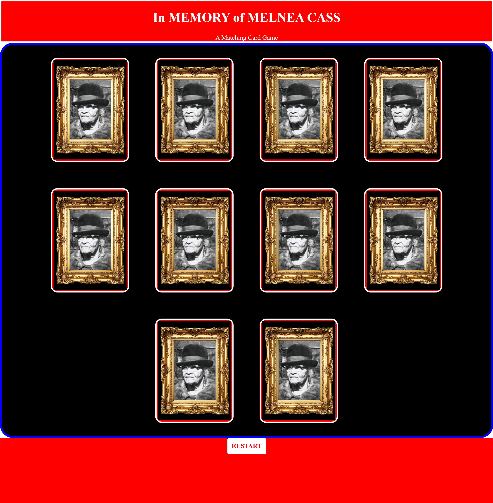

# ♠️ In MEMORY of Melnea Cass: Matching Card Game

## Project Description

A matching card game that displays Melnea Cass history and legacy. Images of Cass herself, the YMCA branch named after her, Melnea Cass Blvd in Roosevelt, MA, Cass receiving her honorary degree from North Eastern University, and an image of Brotherhood of Sleeping Car Porters (Cass founded the Boston chapter). 

The application displays 10 cards with 5 unique images on the back, a reset button at the bottom to start a new game. 

## Tech Stack

- **HTML** 
- **CSS**
- **JavaScript**

## How to Run or View It

1. Clone or download the repository.
2. Open `index.html` in a browser or serve the project using a local development server.
3. Click each card to find the match. If they aren't a match they will flip back over.
4. Once all cards are found a message will display at the bottom

## Screenshots and Demo

### Application Interface

.png)

The interface displays 10 cards with 5 unique images on the back, a reset button at the bottom to start a new game. 
